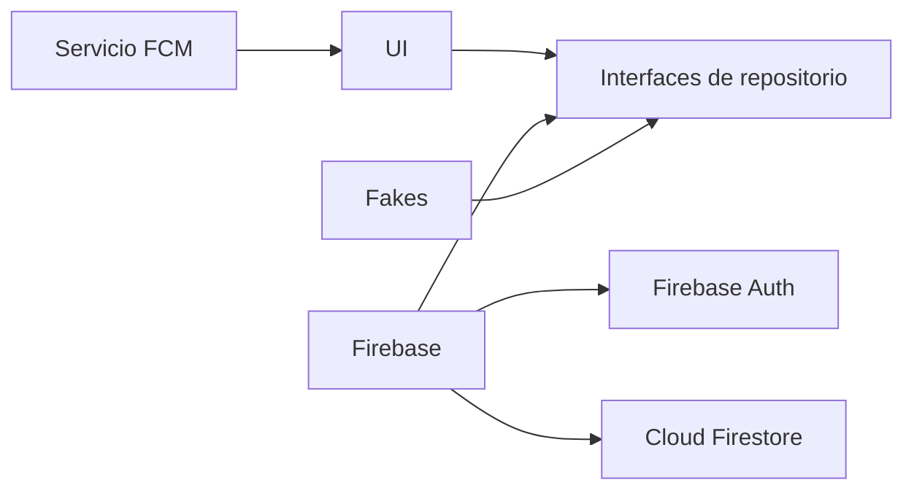

# Mis tareas — integración y pruebas Flutter

Aplicación de tareas por usuario con autenticación, Firestore y notificaciones. Práctica Semana 16 — Integración y pruebas, Electiva 1, UTEC. El proyecto se creó desde cero porque el directorio de trabajo no contenía un proyecto Flutter.

Autor: Oswaldo Guevara — [Carnet]. Repositorio público: [https://github.com/OswaldoGB-INDUPAL/practica-integracion-pruebas-flutter](https://github.com/OswaldoGB-INDUPAL/practica-integracion-pruebas-flutter).

## Arquitectura



La interfaz recibe repositorios por constructor; las pruebas sustituyen Firebase por fakes. Las reglas restringen `users/{uid}/tasks` a su propietario. FCM guarda el token en el documento del propio usuario.

## Versión Android

Descarga el APK firmado o el AAB de la versión 1.0.0 en https://github.com/OswaldoGB-INDUPAL/practica-integracion-pruebas-flutter/releases/tag/v1.0.0. El APK se instaló y abrió en un emulador Android. Con la compilación de depuración se probaron el acceso, las tareas y una notificación FCM en primer plano contra Firebase alojado. Para compilar de nuevo, consulta [Publicación Android](docs/PUBLICACION-ANDROID.md).
## Requisitos y ejecución

- Flutter 3.50.0 / Dart 3.14.0 (versiones usadas para las pruebas), Android SDK y emulador o dispositivo Android API 33 o posterior recomendado.
- Cuenta y proyecto de Firebase, Firebase CLI y FlutterFire CLI.

```sh
git clone https://github.com/OswaldoGB-INDUPAL/practica-integracion-pruebas-flutter.git
cd practica-integracion-pruebas-flutter
git checkout semana16-integracion
flutter pub get
flutterfire configure
firebase use <ID_DEL_PROYECTO>
firebase deploy --only firestore:rules
flutter run
```

Habilita Authentication con correo/contraseña, Firestore y Messaging en Firebase. Regenera la configuración con `flutterfire configure`, coloca el `google-services.json` del proyecto en `android/app/` y no lo subas. `lib/firebase_options.example.dart` es solo un ejemplo; las credenciales y configuraciones reales están ignoradas. El identificador Android es `com.example.practica_integracion_pruebas_flutter`; cámbialo y regístralo en Firebase si tu configuración lo requiere.

```sh
flutter analyze
flutter test
flutter test integration_test/app_flow_test.dart -d <id-dispositivo>
```

Con Flutter 3.50, `flutter analyze` terminó sin observaciones. Las reglas de Firestore también se probaron con el emulador local (4/4); requieren Node.js 20 o superior y Java 21. Para repetirlas: `cd rules_tests`, `npm install` y `npm test`. Las pruebas de `test/` usan fakes y no validan Firebase real. Dos flujos de integración pasaron en Edge: uno con fakes y otro con los repositorios Firebase conectados a emuladores locales de Auth y Firestore. Authentication y Firestore alojados se verificaron mediante sus API con una cuenta temporal; los detalles están en [la evidencia](docs/evidencias/firebase/verificacion-api-real.md). La app compiló y el flujo de integración pasó en un emulador Android con servicios Firebase emulados; [ver evidencia](docs/evidencias/firebase/android-emulador.md). Una prueba en Android con Firebase alojado también verificó acceso, creación, edición y eliminación de tareas y una notificación FCM en primer plano; [ver evidencia](docs/evidencias/firebase/android-firebase-real.md). Los resultados y limitaciones reales están en [la plantilla](docs/03-plantilla-pruebas.md); las capturas previstas están en [capturas](docs/evidencias/capturas-aplicacion/README.md) y [Firebase](docs/evidencias/firebase/README.md). Hay una [captura real de la pantalla de acceso en Android](docs/evidencias/capturas-aplicacion/android-inicio.png); faltan las demás capturas.

## Índice de atestados

| N.º | Atestado | Ubicación |
|---|---|---|
| 1 | Código | [lib](lib/) y [pubspec](pubspec.yaml) |
| 2 | Alcance | [Declaración](docs/01-declaracion-alcance.md) |
| 3 | Flujos | [Mapa](docs/02-mapa-flujos-criticos.md) |
| 4 | Casos | [Plantilla](docs/03-plantilla-pruebas.md) |
| 5 | Incidencias | [Registro](docs/04-registro-incidencias.md) |
| 6 | Evidencias visuales | [Capturas previstas](docs/evidencias/capturas-aplicacion/README.md) |
| 7 | Evidencias Firebase | [Capturas previstas](docs/evidencias/firebase/README.md) |
| 8 | Pruebas | [Tests](test/) y [salida real](docs/evidencias/pruebas-y-analisis/flutter-test.txt) |
| 9 | Análisis | [Salidas](docs/evidencias/pruebas-y-analisis/README.md) |
| 10 | Historial | `git log --oneline` en `semana16-integracion` |
| 11 | Reflexión | [Reflexión](docs/05-reflexion-final.md) |

[Pasos y nombres de evidencias manuales](docs/GUIA-EVIDENCIAS-MANUALES.md). [Notificaciones FCM](docs/evidencias/notificaciones-fcm/README.md).

## Incidencias corregidas

| ID | Corrección | Commit local | Verificación |
|---|---|---|---|
| INC-001 | Limpieza de rutas al cambiar sesión | [192dca4](https://github.com/OswaldoGB-INDUPAL/practica-integracion-pruebas-flutter/commit/192dca4) | Prueba fake aprobada después de corregir |
| INC-002 | El fallo de FCM no bloquea el arranque | [b4ac250](https://github.com/OswaldoGB-INDUPAL/practica-integracion-pruebas-flutter/commit/b4ac250) | Pendiente |
| INC-003 | Paréntesis faltante en pantalla de acceso | [d4cc7be](https://github.com/OswaldoGB-INDUPAL/practica-integracion-pruebas-flutter/commit/d4cc7be) | Compilación de pruebas y suite aprobadas |
| INC-004 | Migración a la API Material vigente | [731d308](https://github.com/OswaldoGB-INDUPAL/practica-integracion-pruebas-flutter/commit/731d308) | Análisis sin observaciones y suite aprobada |
| INC-006 | Limpieza del token al cambiar sesión | [9e43708](https://github.com/OswaldoGB-INDUPAL/practica-integracion-pruebas-flutter/commit/9e43708) | Parcial; FCM real pendiente |
| INC-005 | Registro del token solo en depuración | [5157908](https://github.com/OswaldoGB-INDUPAL/practica-integracion-pruebas-flutter/commit/5157908) | Análisis y suite aprobados; Android pendiente |
| INC-007 | Importación de integración web | [eaa857a](https://github.com/OswaldoGB-INDUPAL/practica-integracion-pruebas-flutter/commit/eaa857a) | Flujo aprobado en Edge con fakes |

La evidencia de Android y Firebase registra el alcance probado; faltan las capturas restantes y pruebas adicionales de FCM.

**Incidencia abierta:** la limpieza del token FCM al cerrar sesión es de mejor esfuerzo y está pendiente de verificar con Firebase; puede quedar asociado sin red o cuando Firestore rechaza la limpieza tras caducar la sesión (INC-006). Evita enviar datos sensibles en notificaciones hasta corregir y verificar su ciclo de vida.
