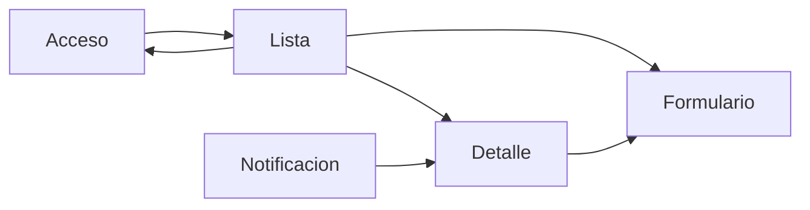

# Mapa de flujos críticos

| ID | Flujo crítico | Pantallas | Servicios | Casos |
|---|---|---|---|---|
| FC-01 | El usuario puede registrarse e iniciar sesión. | Acceso → Lista | Auth | CP-02, CP-03 |
| FC-02 | El usuario puede crear y consultar sus tareas. | Lista → Formulario → Lista | Firestore | CP-04, CP-07, CP-08 |
| FC-03 | El usuario puede editar y eliminar una tarea. | Lista → Detalle → Formulario | Firestore | CP-09, CP-10, CP-21 |
| FC-04 | El usuario puede abrir una tarea desde una notificación. | Sistema → Detalle | FCM | CP-14–CP-17, CP-31–CP-33, CP-36 |
| FC-05 | El usuario puede cerrar sesión sin dejar datos visibles. | Lista → Acceso | Auth | CP-18 |

